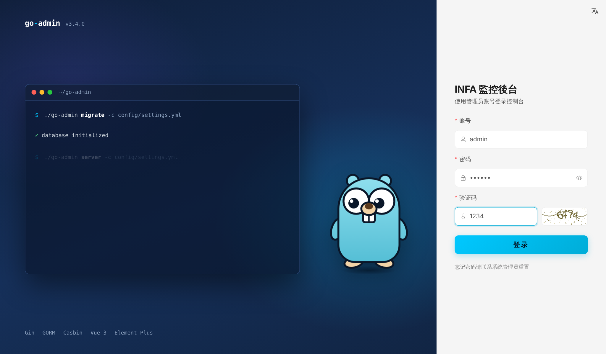
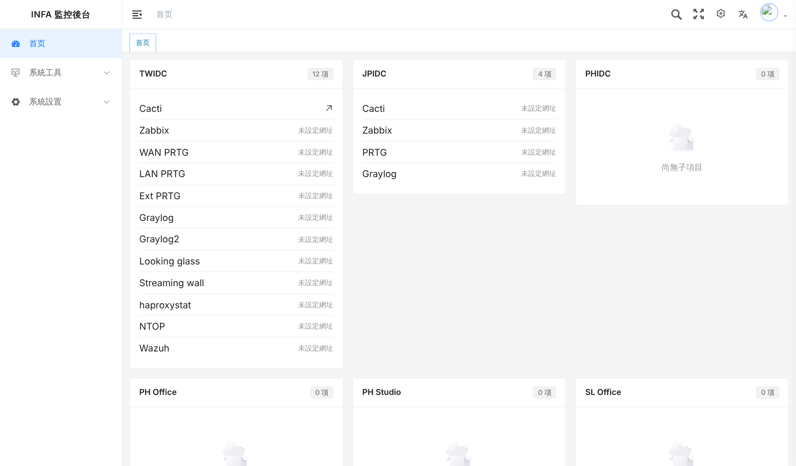
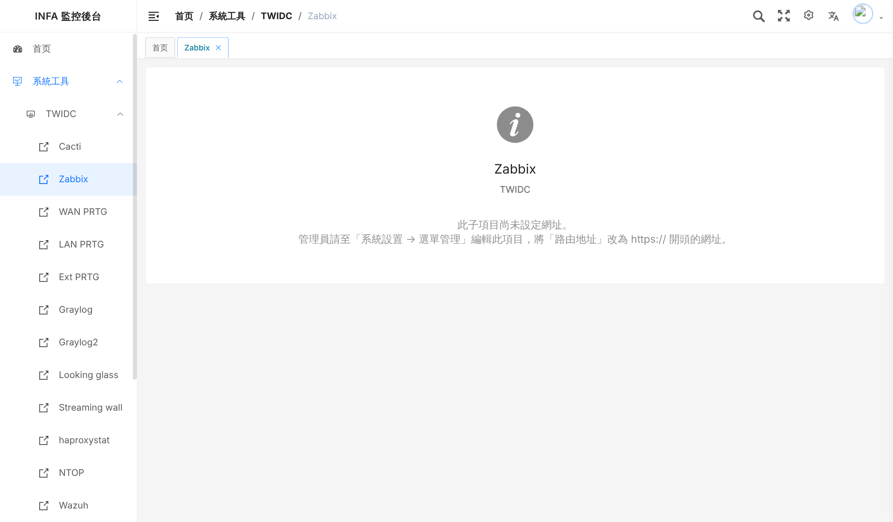
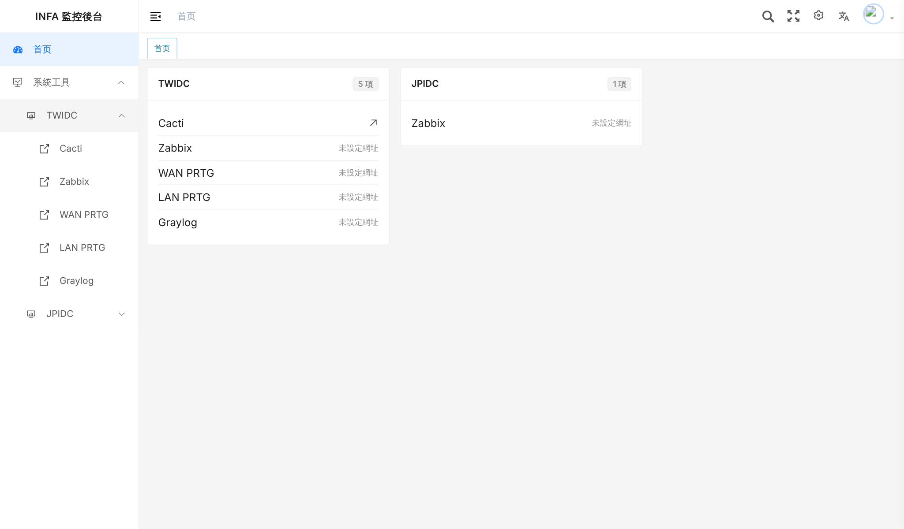
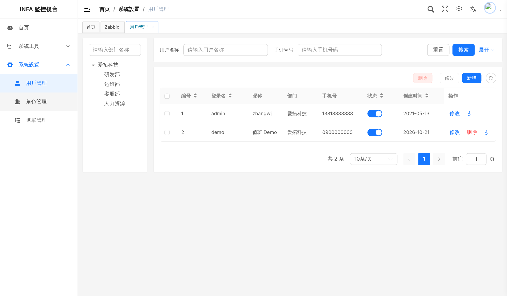
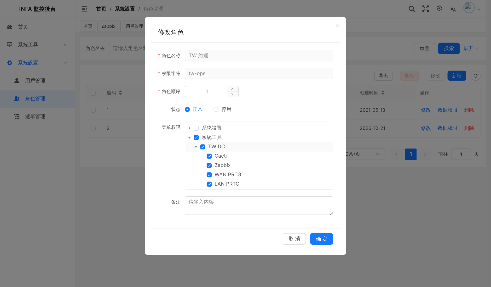
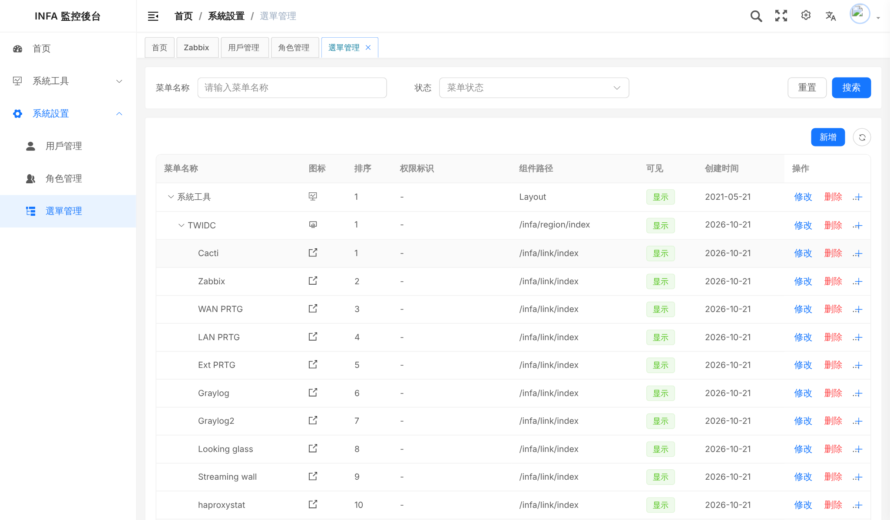

# INFA 監控後台：開發與部署說明

給接手的工程師。需求、畫面、目前做到哪裡、還要做什麼，都在這份文件。

## 1. 需求

- 第一個畫面是**登入**。
- 登入後側邊欄只留兩大項：
  - **系統工具**：六個區域 TWIDC、JPIDC、PHIDC、PH Office、PH Studio、SL Office，點開是各區的監控子項目（Cacti、Zabbix、PRTG…），點子項目就進到該系統。
  - **系統設置**：建立後台帳號與密碼，並設定每個帳號能看到哪些子項目（勾選清單）。
- 用 go-admin 現成功能完成，盡量不寫新程式。

## 2. 對應到 go-admin 的方式

| 需求 | 用 go-admin 的什麼 |
|---|---|
| 六區、子項目 | `sys_menu` 選單：系統工具（目錄）→ 區域（目錄）→ 子項目（選單） |
| 建帳號、密碼 | 系統設置 → 用戶管理（原生） |
| 帳號可看哪些子項目 | 系統設置 → 角色管理 → **菜单权限**勾選（原生），帳號再指定角色 |
| 子項目的網址 | 系統設置 → 選單管理，把子項目的**路由地址**改成 `https://…`；側邊欄與首頁會直接以新分頁開啟 |
| 新增區域的子項目 | 系統設置 → 選單管理 → 在區域那列按「＋」新增 |

go-admin 的權限是「帳號 → 一個角色 → 角色勾選的選單」。所以**同樣權限的人共用一個角色**（例如「TW 維運」只勾 TWIDC）；真的需要每人不同時，就一人一個角色。

## 3. 畫面

| | |
|---|---|
|  登入 |  首頁：六區卡片，只列出有權限的子項目 |
|  尚未設定網址的子項目 |  一般帳號（demo）只看到被勾選的項目 |
|  用戶管理 |  角色管理：勾選可看的子項目 |
|  選單管理：子項目與網址 | |

可直接操作的展示版：https://mootech-asia.github.io/Informatica-Administrator/ （`admin / 123456`、`demo / demo1234`；資料是錄好的，修改不會保存）

## 4. 做了哪些客製

全部改動只有兩份，套在固定版本的上游原始碼上（版本寫在 `scripts/setup.sh`）：

**後端** `infa/backend/1792000000000_infa_menu.go`：放進 go-admin 的 `cmd/migrate/migration/version-local/`，執行 migrate 時：

1. 軟刪除用不到的內建選單（部門、崗位、字典、參數、日誌、定時任務、開發工具、示例模組…），只留「系統設置」底下的用戶、角色、選單管理。它們的 API 還在，只是沒有入口；要找回來把 `sys_menu.deleted_at` 改回 `0`。
2. 「系統工具」放到第一個，加入六個區域與子項目。選單 ID：區域 10100、10200…10600，子項目為區域 ID + 1、+2…
3. 把這些選單授權給 admin 角色，系統名稱改為「INFA 監控後台」。

可重複執行；已存在的選單會被覆寫成定義的內容。

**前端** `infa/frontend.patch`（套在 go-admin-ui 上）：

| 檔案 | 內容 |
|---|---|
| `src/views/dashboard/index.vue` | 首頁換成六區卡片（原本是假的銷售圖表） |
| `src/views/infa/region/index.vue` | 區域目錄的容器頁 |
| `src/views/infa/link/index.vue` | 子項目還沒設定網址時的提示頁 |
| `src/lang/{zh-CN,en-US}/infa.ts` | 以上頁面的文字 |
| `src/App.vue` | 移除上游內建的百度統計追蹤碼 |
| `src/settings.js`、`src/utils/get-page-title.js`、`index.html`、`src/views/login/index.vue` | 瀏覽器分頁標題固定為英文「INFA Monitoring Portal」 |
| `src/demo/*`、`.env.demo`、`src/utils/request.ts`、`vite.config.mjs`、`src/env.d.ts`、`src/views/login/index.vue` | 展示版用：`VUE_APP_DEMO=1` 時 API 改由錄好的回應回答；平常的建置不受影響 |

## 5. 本機開發

需要 Go（版本見 go-admin 的 `go.mod`，設 `GOTOOLCHAIN=auto` 會自動下載）、Node 22、pnpm 9。

```bash
scripts/setup.sh                      # 取得 go-admin、go-admin-ui 並套用客製（可重複執行）

# 後端（本機用 SQLite 最省事；正式環境用 MySQL，見下一節）
cd go-admin
cp config/settings.sqlite.yml config/settings.yml
go build -tags sqlite3 -o go-admin .
./go-admin migrate -c config/settings.yml   # 建表、種子資料、INFA 選單
./go-admin server  -c config/settings.yml   # http://localhost:8000

# 前端
cd ../go-admin-ui
pnpm install --registry=https://registry.npmjs.org   # 上游 .npmrc 指向中國鏡像站
pnpm dev                                           # http://localhost:9527
```

預設帳號 `admin / 123456`。`mode: dev` 時後端不檢查驗證碼。

## 6. 上線前必做

- [ ] `config/settings.yml`：`mode: prod`（開啟驗證碼）、**更換 `jwt.secret`**、資料庫改 MySQL。
- [ ] 登入後**修改 admin 密碼**（預設 123456）。
- [ ] 上游登入頁預設填好 `admin / 123456`（`src/views/login/index.vue` 的 `loginForm`），正式版請清空。
- [ ] 前端 `.env.production` 的 `VUE_APP_BASE_API`：前後端不同網域時填後端網址（並設定後端 CORS）；用反向代理讓兩者同網域則維持空白。
- [ ] 用戶管理的範例部門（爱拓科技、研发部…）改成公司實際部門或只留一個；新增帳號時部門、手機、Email 為必填（上游規則）。
- [ ] 前後端都放在 HTTPS 反向代理後面。

## 7. 還沒有的資料

- PHIDC、PH Office、PH Studio、SL Office 的子項目清單（目前是空的區域）。
- 每個子項目的網址／登入畫面。需求方之後會提供。

拿到後直接在「選單管理」新增或修改即可，不需要改程式。若要讓新環境一開始就有，也可以加進 `infa/backend/1792000000000_infa_menu.go` 的 `infaRegions`。

## 8. 已知限制

- 介面的固定文字是**簡體中文**（go-admin 只提供 zh-CN 與 en-US），選單名稱是資料庫裡的繁體。瀏覽器語言是英文時顯示英文。
- 外部網址的子項目以新分頁開啟，不嵌入後台（多數監控系統禁止被 iframe 嵌入）。
- 角色權限樹的父節點（系統工具、TWIDC）在只勾部分子項目時也顯示為勾選，這是上游的顯示方式，實際權限以子項目為準。

## 9. 升級 go-admin

改 `scripts/setup.sh` 裡的兩個 commit，重新執行；若前端 patch 套不上，手動解衝突後在 go-admin-ui 內重新產生：

```bash
cd go-admin-ui
git add -N .env.demo src/demo src/lang/*/infa.ts src/views/infa
git diff --binary > ../infa/frontend.patch
git reset
```

## 10. 展示版（GitHub Pages）

`.github/workflows/pages.yml` 在 `main` 有變動時自動執行：取得 go-admin-ui、套 patch、`vite build --mode demo`、部署。

展示資料是 `go-admin-ui/src/demo/fixtures.json`。選單或頁面改了之後要重錄：

1. 本機跑起前後端（第 5 節）。
2. 用 admin 建角色「TW 維運」（勾 TWIDC 部分子項目與 JPIDC 的 Zabbix）與帳號 `demo / demo1234`。
3. `BASE=http://127.0.0.1:9527/ node ../infa/tools/record-fixtures.js src/demo/fixtures.json`
4. 依第 9 節重新產生 `infa/frontend.patch`。
